<h1 align="center">Hi, I'm Hammad 👋</h1>

MERN Stack Developer

  
  
  

  

Card regenerates daily from live GitHub data — see <a href="./scripts/generate_card.py">scripts/generate_card.py</a>.

<!---
hammad-waseem/hammad-waseem is a ✨ special ✨ repository because its `README.md` (this file) appears on your GitHub profile.
-->
